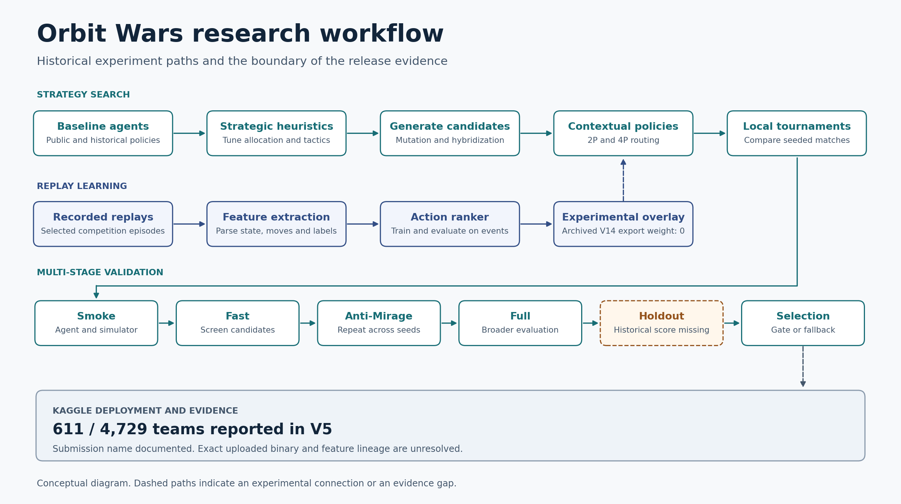

# Orbit Wars: Replay-Based Learning, Automated Agent Search and Multi-Stage Validation

**611th of 4,729 teams (Top 12.92%)**, as recorded in the post-competition report. [Read the 80-page V5 report](docs/research_report/rapport_orbit_wars_v5_post_cloture.pdf) · [Reproduce a small experiment](docs/reproduce.md) · [Explore the data](DATA_DICTIONARY.md)

Orbit Wars is a [Kaggle competition](https://www.kaggle.com/competitions/orbit-wars/) in which autonomous agents launch fleets to capture moving planets in two-player duels and four-player free-for-alls. The research problem was how to select policies that generalize when the opponent population changes. A candidate can improve against a local pool and still lose ground on a different ladder.

*Conceptual workflow. The diagram shows the project’s experimental paths. The V5 report records the placement. The exact uploaded binary and which experimental features it used remain unverified.*

## Research contributions

Florent Schobyn developed the local experiment tools, project variants, training and analysis code, and the research report. The work explored five axes.

| Axis | Project contribution |
| --- | --- |
| Heuristic optimization | Tested changes to resource allocation, target choice, tactical behavior and policy settings around historical baselines. |
| Replay learning | Extracted replay features, built candidate-action examples and trained a linear action ranker. |
| Automated search | Generated, mutated and hybridized candidates and tracked their lineage across generations. |
| Context-dependent policies | Explored distinct 2P and 4P settings and routing. The reusable interface binds its router from the scheduled seat count. |
| Multi-stage validation | Applied progressively broader local checks through Smoke, Fast, Anti-Mirage and Full. Holdout is implemented in the workflow and its historical score is unavailable. |

The work drew on public Kaggle baselines, including Slawek Biel’s Producer line and the named heuristic notebooks in the [source register](PROVENANCE.md). The full third-party policies, derivative packages and unresolved utilities remain outside the release. Researchers can register authorized local copies using the [agent adapter](docs/reproduce.md#register-a-local-agent).

## Historical evidence

| Archive | Recorded observations | What the record supports |
| --- | --- | --- |
| [OrbitLab](results/phase3/orbitlab_individual_matches.csv) | 5,800 match attempts. 1,962 marked OK and 3,838 marked ERROR. | Local tournament activity and outcomes as recorded. Individual terminal statuses are absent. |
| [Evolution](results/evolution_candidates.csv) | 52 candidates across three generations. [253 match attempts](results/evolution_matches.csv), with 8 timeouts and 14 bad outputs. | Observed search and candidate lineage. This archive has its own identifier scheme. |
| [Beast Lab](results/phase3/beast_stage_results.csv) | 312 replay analyses, 16 Fast evaluations and four Full evaluations. | All four Full candidates had negative combined deltas. The documented run recovered zero validated exports and no historical Holdout score. |
| [Replay ranker V14](results/ranker_v14_summary.json) | 134,051 examples, 106 features and [131 training checkpoints](results/phase3/v14_training_curve.csv). Historical validation AUC 0.886154. | The recorded example-level split can mix rows from the same replay. AUC measures the ranking task on that split. The export coefficient was zero, so the learned ranker did not influence that export. |

The archive supports separate counts for each experiment source. Overlap is unknown. The [data dictionary](DATA_DICTIONARY.md) explains missing values and joins. The [experiment manifest](results/phase3/EXPERIMENT_MANIFEST.json) records source fingerprints and table counts. See also the [historical evaluation plot](docs/figures/historical-results.png) and the [V14 training curve](assets/v14-training-curve.png).

## Install and run

Use Python 3.13 for the locally verified release environment. From the repository root, create an isolated environment and activate it.

~~~text
python -m venv .venv
~~~

On Windows PowerShell, run `.\.venv\Scripts\Activate.ps1`. On Linux or macOS, run `source .venv/bin/activate`. Windows x64 was tested in a clean environment. Linux is configured in CI and macOS remains unverified locally. The [reproduction guide](docs/reproduce.md) includes the Windows dependency lock and platform details.

~~~text
python -m pip install -e ".[simulator,analysis,test]"
orbit-research tournament --config configs/tournament.json --out local-runs/tournament
python -m pytest -q -p no:cacheprovider
~~~

This starts four short official-simulator games using the supplied `hold` and `nearest` demo policies. It requires no private archive or account credentials. To extend it:

- [Register your own agent](docs/reproduce.md#register-a-local-agent) and pin its local source by SHA-256.
- [Generate mutations, build a hybrid and run staged validation](docs/reproduce.md#bounded-quickstart). The current search explores Fast-stage candidates under a bounded game budget.
- [Extract replay features, train and score](docs/reproduce.md#replay-features-and-ranking) using authorized local inputs. Phase 3 splits by replay, fits transformations on training rows and assigns tied scores half credit in ROC AUC.
- [Regenerate plots and explore results](docs/reproduce.md#analyze-the-archive). The four notebooks walk through historical outcomes, evolutionary lineage, validation failures and ranker limits.

## Research report and evidence

[**Orbit Wars V5 post-competition report**](docs/research_report/rapport_orbit_wars_v5_post_cloture.pdf) · Florent Schobyn · 15 July 2026 · 80 pages · French

The archived report explains the heuristic experiments, ranking attempts, search and validation results, and retrospective reading of winning reinforcement learning systems. Its [release assessment and methodological note](docs/research_report/PUBLICATION_ASSESSMENT.md) identifies retrospective corrections and records what was checked. The [capture evidence index](assets/README.md) distinguishes submission-name evidence, one replay and the unverified final leaderboard row.

## Repository map

| Area | Contents |
| --- | --- |
| `orbit_wars_research/` | Historical excerpts and a separate `framework/` for post-competition corrections and reproducible interfaces. |
| `configs/`, `tests/` | Bounded examples and regression tests. |
| `results/`, `notebooks/` | Fingerprinted historical measurements and four executable analyses. |
| `docs/research_report/`, `assets/` | Exact V5 report, release assessment, diagram and data-derived plots. |
| `docs/release/` | v0.3.0 notes, publication steps and repository metadata. |

## Limits and follow-up research

The exact replay batch, original Kaggle runtime and final submission bytes have not been reconstructed. The framework uses simplified mutations, Fast-only selection in search, bounded budgets, a single-file third-party agent adapter and exploratory bootstrap intervals. No end-to-end learned gameplay policy has been demonstrated. The documented Kaggle rank remains a historical record.

A useful follow-up would freeze time-separated replay and opponent pools, run seat-balanced comparisons across disjoint seeds and test a nonzero ranker coefficient against a fixed heuristic baseline. Episode-level splits help with near-duplicate and distribution-shift questions, but cannot establish performance against the final historical field.

## Citation, credits and license

Cite Florent Schobyn, *Orbit Wars: Replay-Based Learning, Automated Agent Search and Multi-Stage Validation*, v0.3.0. [Citation metadata](CITATION.cff)

Thanks to Kaggle for the competition and simulator, to the baseline authors and to the competitors who published their solutions. The report’s discussion of winning RL systems credits their authors. [Third-party notices](THIRD_PARTY_NOTICES.md)

Original project-owned contributions are released under [MIT](LICENSE). The license covers those contributions only. Third-party software, agents, data, artwork and cited works retain their own terms. [Provenance and license scope](PROVENANCE.md)

